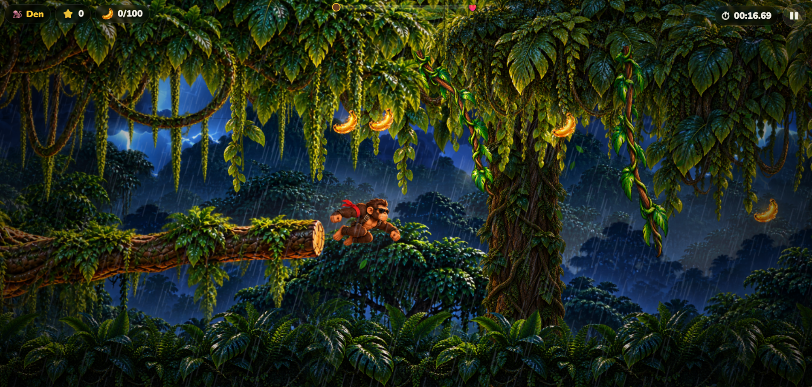
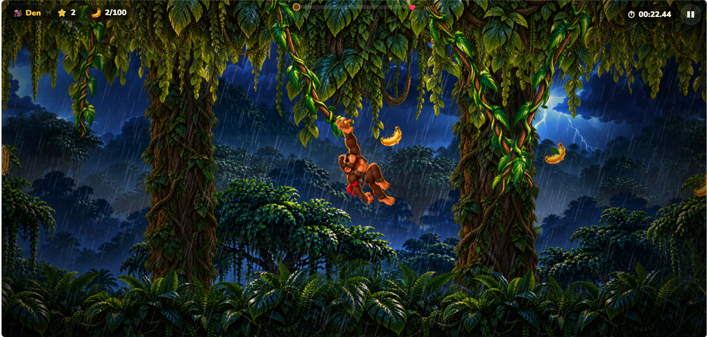

<p align="center">
  
</p>

<h1 align="center">🐒 Monkey Fast</h1>

<p align="center">Uma aventura 2D entre cipós, saltos e tempestades.</p>

<p align="center">
  <a href="#sobre-o-jogo">Sobre</a> ·
  <a href="#gameplay">Gameplay</a> ·
  <a href="#como-executar">Como executar</a> ·
  <a href="#jogue-online">Jogue online</a>
</p>

## Sobre o jogo

**Monkey Fast** é um jogo de aventura e plataforma 2D para navegadores, com rolagem lateral e controles para computador, celular e tablet.

Durante uma tempestade na floresta, um chimpanzé precisa atravessar um percurso de cipós para salvar a Macaquita, ameaçada por uma onça no topo de uma grande árvore. O desafio é aproveitar o balanço, calcular o momento de soltar e alcançar o próximo cipó sem cair.

Você tem **uma vida**, sem checkpoints. Colete bananas, use os poderes das frutas mágicas e chegue ao resgate para concluir a aventura.

### Destaques

- **92 cipós em seis trechos**, com travessias horizontais, subidas, descidas e uma subida diagonal final.
- **Física de pêndulo**, com impulso, captura automática dos cipós e controle para subir ou descer enquanto se balança.
- **100 bananas** distribuídas em alturas variadas próximas às trajetórias dos saltos.
- **Manga Mágica:** aumenta a velocidade e o impulso do personagem durante 7 segundos.
- **Goiaba Mágica:** acelera o balanço dos cipós durante 7 segundos.
- **Floresta com paralaxe**, chuva, névoa, relâmpagos e efeitos de partículas.
- **Áudio sintetizado**, com trilha e efeitos que acompanham os acontecimentos da partida.
- **Cena final de resgate**, telas de vitória e derrota, pausa e ajustes de áudio e qualidade gráfica.
- **Ranking local**, com integração opcional ao Firebase para ranking global.
- **Controles por teclado e toque**, com joystick virtual e botão de pulo nos dispositivos móveis.

### Pontuação

Cada banana e cada power-up coletado valem **1 ponto**. Ao vencer coletando os 104 itens, você recebe o bônus **PERFECT RUN!**:

```text
100 bananas + 4 power-ups = 104 pontos básicos
Bônus perfeito = 104 × 2 = 208 pontos
Pontuação final = 312 pontos
```

No ranking, a maior pontuação fica à frente; em caso de empate, vence o menor tempo de conclusão. Somente partidas vencidas entram no ranking.

## Gameplay

### Saltos entre os cipós



### Explorando a floresta



## Tecnologias utilizadas

| Tecnologia | Aplicação no projeto |
| --- | --- |
| **JavaScript com ES Modules** | Lógica do jogo, simulação física e organização dos módulos |
| **Phaser 3.90** | Cenas, sprites, animações, câmera e efeitos visuais |
| **HTML5 e CSS3** | Menus, HUD, configurações e interface responsiva |
| **Vite 7** | Servidor de desenvolvimento e build de produção |
| **Web Audio API** | Música e efeitos sonoros sintetizados |
| **Vitest 3** | Testes de física, coleta, pontuação, geração da fase e validação de resultados |
| **Firebase** | Hosting, Firestore, autenticação anônima e Cloud Functions para o ranking global |
| **Sharp** | Processamento de imagens e preparação dos assets |

## Pré-requisitos

Para executar o projeto localmente:

- **Node.js 22.12 ou superior** e **npm**.
- **Git**, para clonar o repositório, ou o arquivo ZIP baixado pelo GitHub.
- Navegador atualizado com suporte a Canvas/WebGL e Web Audio.

Para usar as Cloud Functions, utilize **Node.js 22**, conforme a configuração de `functions/package.json`. O Firebase é opcional para jogar localmente: sem configuração, o ranking é salvo no navegador.

## Como executar

Clone o repositório e instale as dependências:

```bash
git clone https://github.com/DenilsomLobo/monkey_fast.git
cd monkey_fast
npm install
npm run dev
```

Abra **http://localhost:5173** ou o endereço informado pelo Vite no terminal.

No Windows, também é possível iniciar pelo arquivo **`Jogar Monkey Fast.cmd`**, que abre o servidor de desenvolvimento e o navegador. Mantenha a janela do terminal aberta enquanto joga.

### Controles

| Ação | Computador | Celular / tablet |
| --- | --- | --- |
| Andar e impulsionar o balanço | **A / D** ou **← / →** | Joystick virtual para os lados |
| Subir e descer pelo cipó | **W / S** ou **↑ / ↓** | Joystick virtual para cima ou para baixo |
| Pular ou soltar o cipó | **Espaço** | Botão **PULAR** |
| Pausar | **Esc** ou **P** | Botão de pausa |

O macaco agarra automaticamente um cipó quando suas mãos entram na área de captura. Em celulares e tablets, prefira a orientação horizontal.

### Testes e build

```bash
npm test          # Executa os testes automatizados
npm run build    # Gera a versão de produção em dist/
npm run preview  # Abre uma prévia local do build
```

Os testes incluem partidas simuladas com coleta das 100 bananas e dos quatro power-ups, conclusão da fase e validação do bônus perfeito.

## Estrutura do projeto

```text
monkey_fast/
├── assets/          # Artes originais, capa e imagens de gameplay
├── public/assets/   # Imagens, sprites e recursos carregados pelo jogo
├── src/
│   ├── core/        # Física, geração da fase, coleta e regras de pontuação
│   ├── entities/    # Personagens, cipós, bananas e power-ups
│   ├── scenes/      # Menu, partida, vitória, derrota e ranking
│   ├── systems/     # Áudio, cenário, câmera, controles e efeitos
│   ├── services/    # Persistência local e integração com Firebase
│   ├── ui/          # HUD, telas e controles virtuais
│   └── styles/      # Estilos da interface
├── functions/       # Backend do ranking global
├── scripts/         # Preparação de assets e certificação de rotas
├── tests/           # Testes automatizados
└── docs/            # Documentação técnica
```

## Firebase e publicação

O projeto inclui a estrutura para publicar no **Firebase Hosting** e habilitar o ranking global com **Firestore**, **Authentication anônima** e **Cloud Functions**.

Para conectar seu próprio projeto, use `.env.example` e `.firebaserc.example` como modelos, instale as dependências de `functions/` e siga o [guia de configuração e publicação](docs/DEVELOPMENT.md#firebase-ranking-global-e-publicação).

Os resultados são enviados às Cloud Functions para validar itens, tempo e pontuação. A validação atual verifica a plausibilidade da partida; não implementa replay completo para proteção antifraude.

Consulte também a [documentação técnica](docs/DEVELOPMENT.md) para ajustes de física, assets e rotas de coleta.

## Jogue online

🎮 **Link para jogar:** _em breve — espaço reservado para o endereço da versão publicada._

<!-- Substitua a linha acima por: 🎮 [Jogar Monkey Fast](URL_DO_JOGO) -->

---

## Autor

**Denilsom Lobo**

Conheça meus outros projetos no [meu portfólio](https://portifolio-denilsom-lobo.web.app/).
